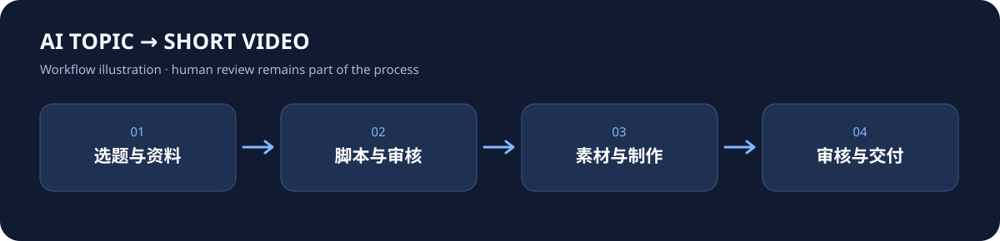
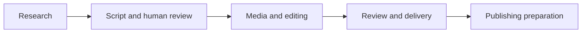

# How to Use AI · Topic-to-Video Workspace

**[中文](README.md) | English**

A source snapshot of an AI-assisted workflow for researching topics, preparing scripts, selecting media, editing and reviewing short videos, and organizing delivery materials. Human review remains part of the process.

> **Scope:** This is a V330 source snapshot from October 28, 2026, for developers and creators to study and extend. It is not a turnkey hosted service or a complete production backup. The production workspace remains private. Production data, private videos, credentials, runtime state, and external service accounts are not included.



The diagram illustrates the workflow; it is not a recording of a completed production run.

## What is included

- A topic research workspace and source-material organization.
- Script, review, version and feedback workflows, including human review.
- Code and tests for media preparation, editing, templates, covers and delivery materials. Some stages require separately configured services or a local executor.

The snapshot uses TypeScript, React, Vinext/Vite, with Sites, Cloudflare D1 and R2 in the original deployment. The code is provided for inspection and further development; this repository does not provide a ready-to-use video generation service.

## Quick start: see the local interface

Requires Node.js **22.13.0 or later** and npm. Run in a separate directory:

```bash
git clone https://github.com/Sioune/siounex-ai-topic-video.git
cd siounex-ai-topic-video
npm run install:ci
npm run dev
```

With the portable development profile, open **http://127.0.0.1:5173/signin-with-chatgpt?return_to=/**. It uses a local mock identity. You should see the workspace shell with **选题库** (topics), **制作与审稿** (production and review), and **发布中心** (publishing) in the navigation. An uninitialized local database can show **暂时连不上选题库** (topic library unavailable); seeing the shell does not mean production data or integrations are configured.

A fresh clone was tested on October 29, 2026 with Node.js 24.14.0: dependency installation, local server startup and the home page worked. This did not test end-to-end production. See [development notes](docs/handoff/development.md) and [environment details](docs/handoff/STARTER-README.md).

## Assets and repository size

GitHub currently reports approximately **46 MB** for the repository; this is a repository-size indicator, not a guaranteed download size. Three outro videos are stored as chunks under `.snapshot-assets/` (about 18.2 MB total), and another outro video is tracked directly under `production/assets/` (about 6.4 MB). The repository also includes brand images, source and tests.

The chunks are part of a normal clone; skipping restoration does **not** skip their download. You can skip restoration to inspect the local interface, but media workflows that need those assets will be incomplete. When you need them, run:

```bash
node scripts/restore-snapshot-assets.mjs
```

The script verifies and restores the three files locally without contacting the production site or starting a production job. This has not been migrated to Git LFS or a separate optional download.

## Architecture and status



- [Historical handoff and known issues](docs/handoff/current-progress.md) — a historical record, not current live status.
- [Source snapshot manifest](docs/handoff/source-manifest.json).
- [Roadmap and feedback](https://github.com/Sioune/siounex-ai-topic-video/issues/1).
- [Draft launch copy](docs/promo/launch-drafts.md) — for review; not a claim that it has been posted.

When reporting issues, please remove credentials, private account data and non-public media.

## License

Project-owned code is available under the [MIT License](LICENSE). Third-party components, fonts, services, media and brand assets may have separate terms; see [NOTICE](NOTICE.md).
