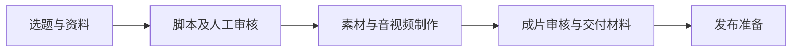

# 怎么用好 AI · 选题到视频工作台

**中文 | [English](README.en.md)**

An AI-assisted topic-to-video workflow source snapshot for developers and creators. It is not a turnkey hosted service; production data and external accounts are not included.

面向内容创作者与开发者的 **AI 选题 → 脚本 → 短视频制作工作流源码快照**。项目把资料收集、脚本审核、视频制作与交付组织到同一个工作台，减少在多个工具之间搬运内容。

> **项目状态：**这是更新至 2026 年 10 月 29 日的源码快照，供学习与研究，并非完整生产备份。生产数据、凭据和私人视频不在本次更新中。连接的站点和任务标识使用示例值；详见 [更新说明](docs/handoff/update-2026-10-29.md)。


## 主要内容

- **选题与资料**：管理选题、来源与素材，并为脚本准备上下文。
- **脚本与审核**：组织口播稿、审核意见和作品版本，保留人工审核环节。
- **制作与交付**：包含素材处理、音视频拼装、模板、封面及宣发准备的代码和测试；部分步骤依赖外部服务、本机执行器与配置。

上图为流程示意，不是成片截图。实际功能与运行结果取决于配置和外部服务；快照不附带即开即用的视频生成服务。

## 快速开始

需要 Node.js **22.13.0 或更高版本** 和 npm。在独立目录中：

```bash
git clone https://github.com/Sioune/siounex-ai-topic-video.git
cd siounex-ai-topic-video
npm run install:ci
npm run dev
```

使用便携开发模式，打开 **http://127.0.0.1:5173/signin-with-chatgpt?return_to=/**，会使用本地模拟身份进入首页。能看到「选题库」「制作与审稿」「发布中心」导航及「下一条，拍什么？」标题，即说明界面外壳已启动。初次本地数据库没有初始化时，选题区域可能显示「暂时连不上选题库」；外壳出现不代表选题数据和视频制作链路已经可用。

2026 年 10 月 29 日已在全新克隆中验证依赖安装、本地开发服务器和首页（Node.js 24.14.0）；另在未还原片尾的隔离副本验证了界面外壳。真实生产链路未在此测试。详见 [本地开发说明](docs/handoff/development.md) 和 [环境说明](docs/handoff/STARTER-README.md)。

### 仓库体积与片尾资源

GitHub 当前显示仓库约 **46 MB**，这是仓库大小指标，不等于每次克隆的准确下载量。三个片尾以分块放在 `.snapshot-assets/`，合计约 **18.2 MB**；另一个片尾视频直接存放于 `production/assets/`，约 **6.4 MB**。仓库还包含品牌图片、源码和测试。

普通 `git clone` 会下载这些分块；**跳过还原不能跳过下载**。只查看本地界面时可暂不还原，涉及片尾的媒体制作则需要这些资源。需要时运行：

```bash
node scripts/restore-snapshot-assets.mjs
```

脚本离线校验并还原三个文件，不连接生产站、不发起制作。目前尚未迁移至 Git LFS 或独立的可选下载。

## 范围与架构



应用使用 TypeScript、React、Vinext/Vite，部署侧使用 Sites、Cloudflare D1 和 R2；本机脚本负责部分媒体制作。快照保留代码、迁移、测试和部分品牌资源，不含生产数据、私有视频、凭据、运行状态或所有第三方服务，因此不能视为生产环境的完整备份。

## 项目状态与参与

- [当前进展与已知问题](docs/handoff/current-progress.md)：历史交接记录，不代表实时线上状态。
- [源码快照清单](docs/handoff/source-manifest.json)
- [提出问题或建议](https://github.com/Sioune/siounex-ai-topic-video/issues)
- [中英文宣传文案（待复核，未发布）](docs/promo/launch-drafts.md)

欢迎通过 Issue 分享启动问题、使用场景和改进建议。提交问题时请删除账号信息、令牌和私人素材。

## 许可

项目自有代码采用 [MIT License](LICENSE)。第三方依赖、字体、素材和品牌标识的权利及适用条款见 [NOTICE](NOTICE.md)；MIT 许可不授予对它们的额外权利。
