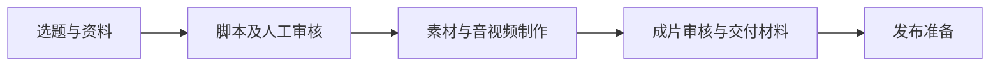

# 怎么用好 AI · 选题到视频工作台

面向内容创作者与开发者的 **AI 选题 → 脚本 → 短视频制作工作流源码快照**。项目把资料收集、脚本审核、视频制作与交付组织到同一个工作台，减少在多个工具之间搬运内容。

> **项目状态：**这是截至 2026 年 10 月 28 日的 V330 源码快照，供阅读、研究和继续开发。它不是可直接部署的完整 SaaS，也不包含生产数据库、用户内容、凭据或外部服务账号。正式工作台仍为私人站点。


## 主要内容

- **选题与资料**：管理选题、来源与素材，并为脚本准备上下文。
- **脚本与审核**：组织口播稿、审核意见和作品版本，保留人工审核环节。
- **制作与交付**：包含素材处理、音视频拼装、模板、封面及宣发准备的代码和测试；部分步骤依赖外部服务、本机执行器与配置。

上图为流程示意，不是成片截图。实际功能与运行结果取决于配置和外部服务；快照不附带即开即用的视频生成服务。

## 快速开始

需要 Node.js **22.13.0 或更高版本** 和 npm。在独立目录中：

```bash
git clone https://github.com/Sioune/siounex-ai-topic-video.git
cd siounex-ai-topic-video
node scripts/restore-snapshot-assets.mjs
npm run install:ci
npm run dev
```

2026 年 10 月 29 日已在全新克隆中验证资源还原、依赖安装及本地开发服务器启动（Node.js 24.14.0）。该验证不覆盖真实生产链路。

还原脚本会离线校验分块并恢复三个片尾文件；它不会连接生产站或发起制作。依赖安装需要访问 npm。开发服务器默认监听本机端口 5173；登录、数据库、对象存储和媒体服务需要按环境单独配置。**能够启动页面不等于完整制作链路已配置完成。** 详见 [本地开发说明](docs/handoff/development.md) 和 [环境说明](docs/handoff/STARTER-README.md)。

## 范围与架构



应用使用 TypeScript、React、Vinext/Vite，部署侧使用 Sites、Cloudflare D1 和 R2；本机脚本负责部分媒体制作。快照保留代码、迁移、测试和部分品牌资源，不含生产数据、私有视频、凭据、运行状态或所有第三方服务，因此不能视为生产环境的完整备份。

## 项目状态与参与

- [当前进展与已知问题](docs/handoff/current-progress.md)：历史交接记录，不代表实时线上状态。
- [源码快照清单](docs/handoff/source-manifest.json)
- [提出问题或建议](https://github.com/Sioune/siounex-ai-topic-video/issues)

欢迎通过 Issue 分享启动问题、使用场景和改进建议。提交问题时请删除账号信息、令牌和私人素材。

## 许可

项目自有代码采用 [MIT License](LICENSE)。第三方依赖、字体、素材和品牌标识的权利及适用条款见 [NOTICE](NOTICE.md)；MIT 许可不授予对它们的额外权利。
